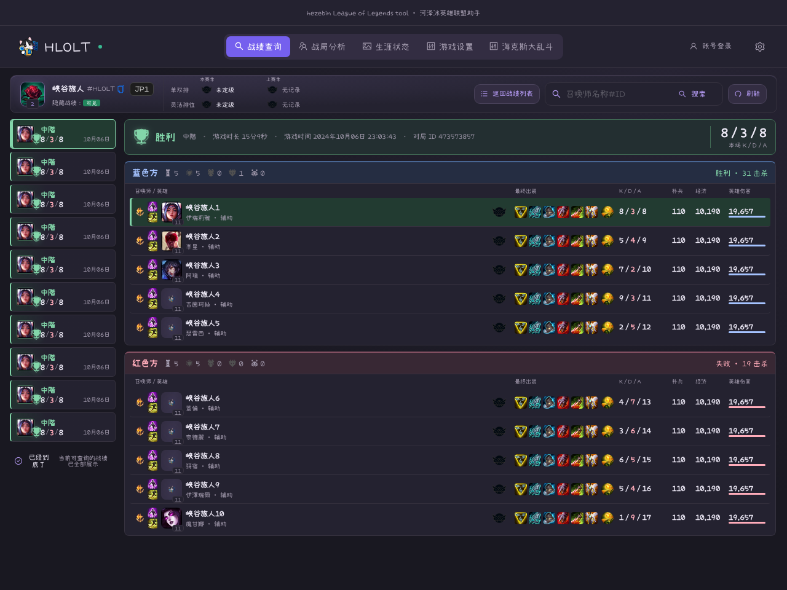
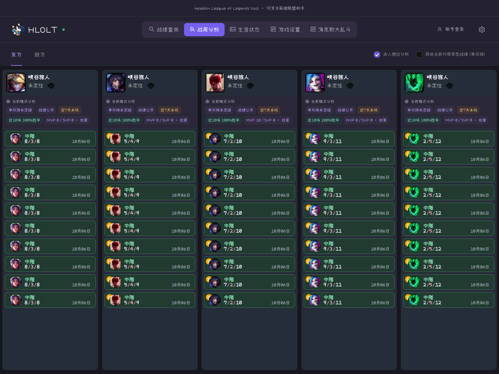
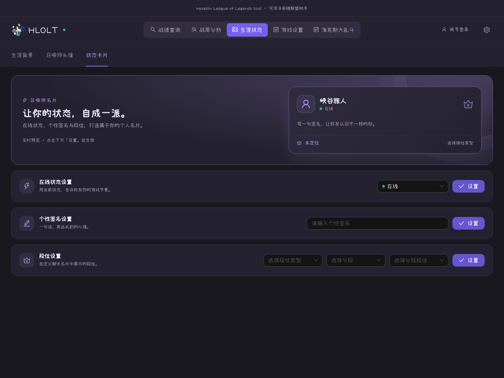
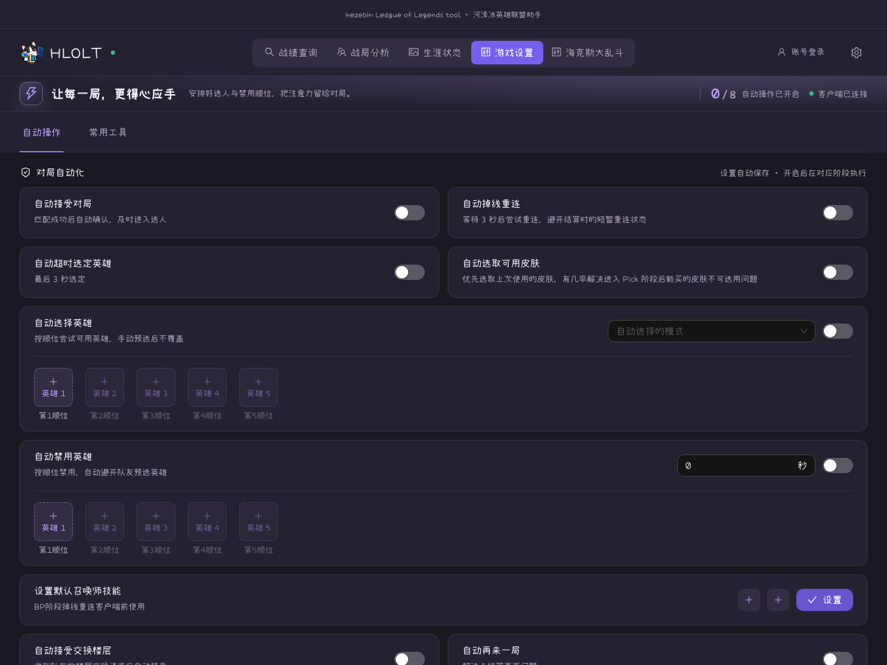
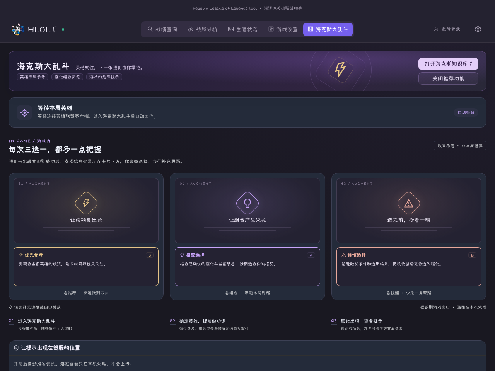
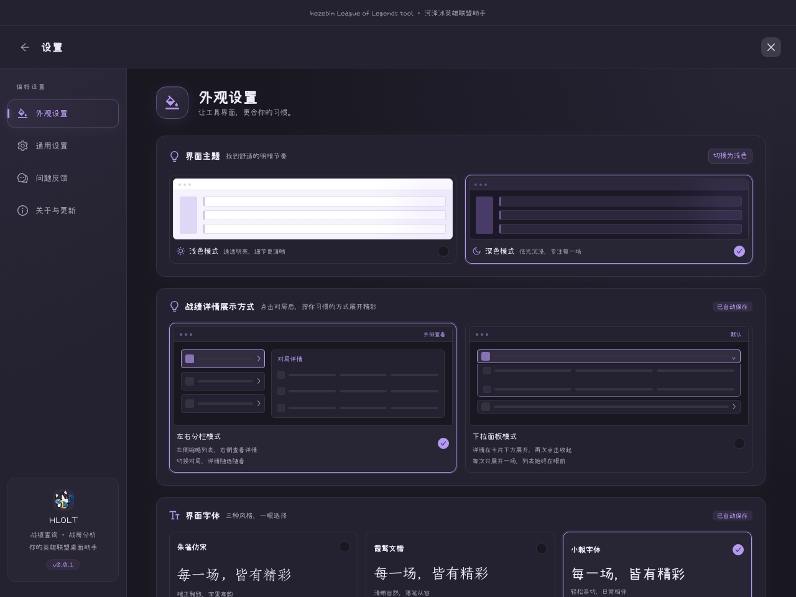

  
  <h1>HLOLT</h1>
  
<strong>每一场对局，都更得心应手。</strong>

  
河泽冰英雄联盟助手。 回顾战绩、了解战局、管理客户端设置，把常用功能放在一起。

  

    
    
  

  
macOS · Windows &nbsp; / &nbsp; 战绩查询与战局分析 &nbsp; / &nbsp; 浅色与深色主题

  
<a href="#功能亮点">功能亮点</a> · <a href="#功能截图">功能截图</a> · <a href="#下载与开始使用">下载与安装</a> · <a href="https://lol.hezebin.com">官方网站</a> · <a href="https://github.com/ihezebin/HLOLT/issues">反馈与建议</a>

---

## 从赛前准备，到赛后回顾

开局前，安排好英雄选择与禁用顺位；进入对局，了解可获取的队友与对手信息；结束后，回顾出装、伤害与关键数据。

HLOLT 将战绩查询、战局分析、生涯个性化和常用自动操作整合到桌面窗口中。连接英雄联盟客户端，就能从熟悉的功能开始使用。

## 功能亮点

| | 常用功能，解决具体需求 |
| --- | --- |
| **🔎 战绩查询** | 查询召唤师近期对局，查看胜负、KDA、出装与伤害等数据；支持左右分栏或下拉面板查看详情。 |
| **👥 战局分析** | 根据当前对局阶段展示可获取的队伍信息，结合近期战绩与分析标签，了解队友和对手。 |
| **🎨 生涯状态** | 设置生涯背景、召唤师头像与状态卡片，让客户端展示更合自己的习惯。 |
| **⚡ 游戏设置** | 按需开启自动接受对局、自动选人、自动禁用、掉线重连等操作，减少重复点击。 |
| **✨ 海克斯大乱斗** | 跟随本局英雄查阅强化与装备资料，提供海克斯选择参考，并可打开知识库继续了解。 |
| **🌗 外观设置** | 切换浅色与深色主题、选择字体和战绩详情展示方式，找到舒服的阅读节奏。 |

### 战绩细节，按自己的方式看

想连续浏览多场对局，可以使用左右分栏；想在列表中直接展开一局，则选择下拉面板。近期表现与单局数据放在一起，回顾时少些来回切换。

### 常用操作，按需开启

自动接受、选人、禁用等选项分别设置，在对应的客户端阶段执行。英雄选择支持顺位配置，自动禁用会避开队友预选英雄；皮肤选择以账号可用资源为准。

### 海克斯选择，多一份参考

在支持的模式和服务状态下，海克斯助手结合本局英雄与资料提供参考。推荐内容受版本、资料与识别状态影响，具体出装与选择仍由你决定。

## 功能截图

以下为当前桌面端界面的渲染截图，使用脱敏演示数据；战绩与战局不代表真实玩家表现，海克斯页面展示的是待命与效果示意。实际内容以所用版本、客户端状态及可获取的数据为准。

### 战绩查询 · 回顾每一局的细节

从近期胜负到单局详情，查看英雄、KDA、伤害与对局记录。

### 战局分析 · 了解当前队伍

集中查看当前队伍的召唤师信息、近期战绩与分析标签，为对局准备提供参考。

### 生涯状态 · 展现召唤师个性

通过状态卡片调整客户端展示，也可切换到生涯背景与召唤师头像设置。

### 游戏设置 · 把注意力留给对局

按需配置自动操作、选人与禁用顺位，常用选项集中管理。

### 海克斯大乱斗 · 给下一次选择一点灵感

查看助手状态、推荐效果示意与提示位置设置，进入支持的对局后获取相应参考。

### 主题与字体 · 找到舒服的阅读节奏

明暗主题、详情布局与字体，在外观设置中统一调整。

## 下载与开始使用

前往 **[最新版本下载页 →](https://github.com/ihezebin/HLOLT/releases/latest)**，或通过 **[官方网站](https://lol.hezebin.com)** 查看下载入口。可用平台和安装包以实际发布附件为准。

| 你的设备 | 选择的安装包 | 安装方式 |
| --- | --- | --- |
| **Mac · Apple Silicon**（M 系列芯片） | 文件名含 `arm64` 的 `.dmg` | 打开安装包，将 HLOLT 拖入 Applications。 |
| **Mac · Intel** | 文件名含 `x64` 的 `.dmg`（如该版本提供） | 打开安装包，将 HLOLT 拖入 Applications。 |
| **Windows · 64 位** | `HLOLT.exe` 安装引导包，或旧版 `*-setup.exe` | 双击安装包，按引导完成安装。 |

Windows 带 `engine` 的附件用于自动更新，首次安装请使用安装引导包。

**三步开始使用：**

1. **安装并阅读说明**：首次启动时阅读并确认应用内免责声明。
2. **启动英雄联盟客户端**：登录游戏账号，等待 HLOLT 连接；需要账号的功能按界面提示登录 HLOLT。
3. **选择需要的功能**：查询战绩、查看战局，或按自己的习惯配置自动操作与外观。

后续可在应用的 **设置 → 关于与更新** 中查看版本与检查更新。

## 你可能想了解

<strong>需要先启动英雄联盟客户端吗？</strong>

战绩、战局分析与客户端设置依赖英雄联盟客户端提供的数据和接口。请先启动并登录客户端，等待 HLOLT 显示连接成功。部分页面可以在未连接时浏览，但不会因此产生实时对局数据。

<strong>能查看所有玩家或所有历史对局吗？</strong>

可查询内容受客户端接口、隐私设置、对局阶段与服务器限制影响。隐藏身份、不可获取的信息或暂时无法加载的历史记录，不保证能够展示。

<strong>HLOLT 账号和游戏账号是一回事吗？</strong>

不是。游戏账号在英雄联盟客户端中登录；HLOLT 账号用于应用自身的登录与相关功能，可按应用提供的邮箱或微信登录入口操作。

<strong>海克斯助手为什么没有显示本局推荐？</strong>

请检查功能开关、当前游戏模式、客户端连接与页面状态提示。未进入支持的模式、资料尚未就绪或服务维护时，页面可能显示待命或效果示意；示意卡片不代表本局推荐。

<strong>这是官方工具吗？</strong>

HLOLT 是独立开发的第三方工具，并非 Riot Games 或英雄联盟运营方推出的官方产品。使用前请阅读应用内免责声明，并遵守所在服务器的最新规则；不承诺官方认可或账号绝对安全。

## 仓库与反馈

- **GitHub 仓库**：[ihezebin/HLOLT](https://github.com/ihezebin/HLOLT)
- **Git 克隆地址**：`https://github.com/ihezebin/HLOLT.git`
- **问题反馈**：[提交 Issue](https://github.com/ihezebin/HLOLT/issues)，请附上系统、应用版本、复现步骤与相关截图。
- **官方网站**：[lol.hezebin.com](https://lol.hezebin.com)

---

  
<strong>准备更从容，回顾更清晰。</strong>

  
<a href="https://github.com/ihezebin/HLOLT/releases/latest">↓ 下载 HLOLT</a> &nbsp; · &nbsp; <a href="https://github.com/ihezebin/HLOLT/issues">💬 问题反馈</a> &nbsp; · &nbsp; <a href="https://hezebin.com">↗ 关于作者</a>

  
如果 HLOLT 对你有帮助，欢迎留下一颗 ⭐。

